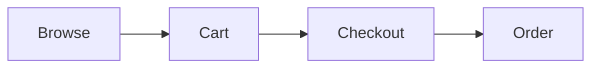
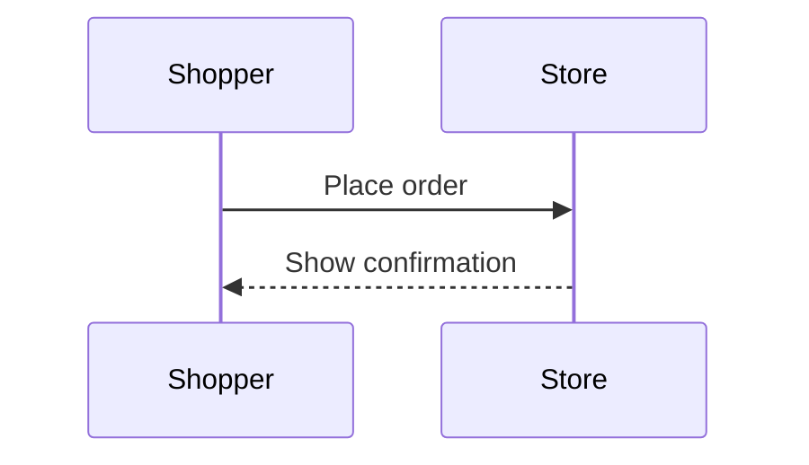
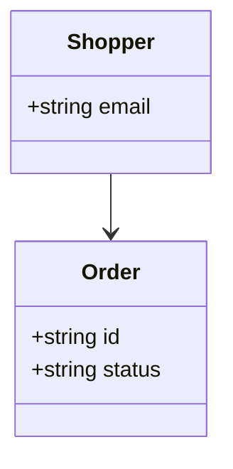
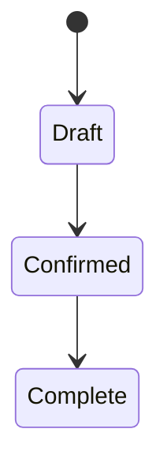
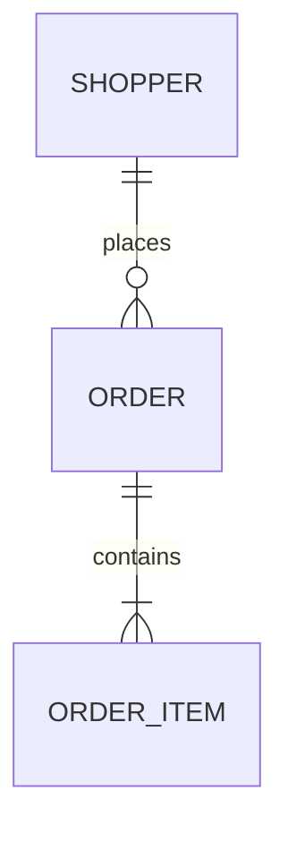
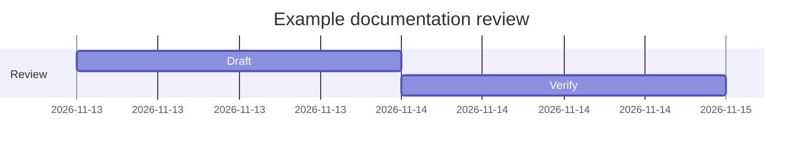
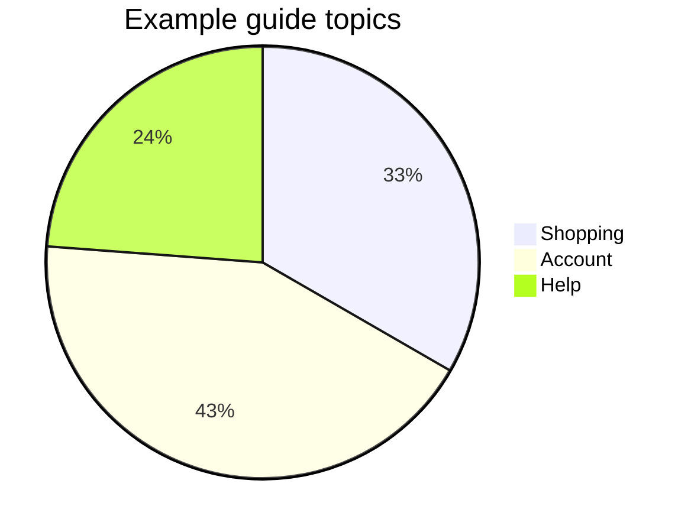
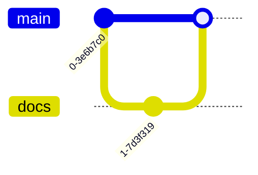
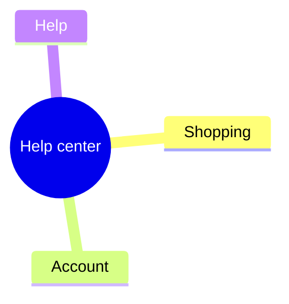

# مرجع كتابة Markdown وMDX

هذه **صفحة مرجعية للمحررين** وليست دليلاً للمتسوق. استخدم فقط الصيغ التي تجعل الدليل أوضح، وأبقِ الأدلة العملية قصيرة ومركزة.

## النص والعناوين

يمكن أن تحتوي الفقرة على نص **عريض** و*مائل* و***عريض مائل*** و~~مشطوب~~. استخدم `النص البرمجي المضمن` للقيم الحرفية. اهرب علامة مثل \* إذا أردت إظهارها كما هي. أضف مسافتين في نهاية السطر لفصل السطر يدوياً.  
تبدأ هذه الجملة في سطر جديد. استخدم الرموز التعبيرية مثل ✅ باعتدال.

### عنوان من المستوى الثالث

#### عنوان من المستوى الرابع

##### عنوان من المستوى الخامس

###### عنوان من المستوى السادس

> الاقتباس مناسب لنص منقول حرفياً. انسبه إلى مصدره وأبقِه قصيراً.

---

## القوائم والجداول

1. ابدأ بالخطوة الأولى.
2. أكمل الخطوة الثانية.
   1. أضف خطوة متداخلة عندما تكون جزءاً من الخطوة السابقة.

- عنصر غير مرقم.
  - عنصر متداخل يضيف تفصيلاً.
- عنصر آخر.

- [x] تأكد من عنوان المقالة.
- [ ] تحقق من الصورة في المتجر المباشر.

| الصيغة | الاستخدام |
| --- | --- |
| جدول | مقارنة عدد صغير من الخيارات |
| قائمة | عرض الإجراءات بالترتيب |

## الروابط والصور والتنقل

استخدم [نظرة عامة على التسوق](/ar/docs/shopping) للرابط العادي. تبقي صيغة [الرابط المرجعي][account-guide] العنوان الطويل خارج الفقرة. يذهب [رابط العنوان](#المكونات-وhtml) إلى عنوان في هذه الصفحة. افحص الروابط النسبية مثل `./shopping/index.md` قبل النشر؛ تستخدم الأدلة العامة حالياً روابط تتضمن اللغة.


[](/ar)

يُنشأ جدول المحتويات من عناوين الصفحة. تحدد بيانات YAML في أعلى الملف عنوان الصفحة ووصفها.

## الشيفرة والكتل التقنية

تحدد اللغة بعد علامات السياج التلوين البرمجي:

```js
const guide = { locale: "ar", published: true };
console.log(guide.locale);
```

اذكر الطلب والمعاملات والاستجابة في توثيق API. المثال التالي توضيحي **وليس** نقطة وصول من سيلزوايز:

```http
GET /example/orders/{id} HTTP/1.1
Accept: application/json
```

| المعامل | النوع | المعنى |
| --- | --- | --- |
| `id` | string | معرّف طلب تجريبي |

استخدم كتلة فروقات لعرض تغيير صغير:

```diff
-عنوان الدليل السابق
+عنوان الدليل الجديد
```

لاختصار لوحة المفاتيح اكتب `<kbd>Ctrl</kbd> + <kbd>K</kbd>`. يُكتب الأس والرمز السفلي بصيغتي `x<sup>2</sup>` و`H<sub>2</sub>O`. ويمكن شرح الاختصار بصيغة `<abbr title="واجهة برمجة التطبيقات">API</abbr>`. تُعرض أمثلة HTML هنا كمصدر لأن عارض Markdown لا يحتفظ بكل عناصر HTML.

## المكونات وHTML

```mdx
import { Callout } from 'fumadocs-ui/components/callout';

<Callout type="info" title="معلومة">
  تُبرز الملاحظة تفصيلاً يحتاجه القارئ في المهمة الحالية.
</Callout>

<Callout type="warning" title="تحقق قبل النشر">
  يجب أن يصف التحذير قيداً أو نتيجة حقيقية.
</Callout>
```

للتنبيهات والملاحظات صيغ مصدرية أيضاً. فعّل إضافة العرض المناسبة قبل استخدامها في دليل للمتسوق:

```md
> [!NOTE]
> تحقق من خيارات الدفع الحالية في المتجر المباشر.

:::warning
راجع مجموع الطلب قبل تأكيده.
:::
```

```mdx
import { Tabs, Tab } from 'fumadocs-ui/components/tabs';

<Tabs items={["Markdown", "MDX"]}>
  <Tab>يدعم Markdown النصوص والقوائم والروابط والصور والجداول والشيفرة.</Tab>
  <Tab>يستطيع MDX عرض مكونات React المستوردة مثل هذه التبويبات.</Tab>
</Tabs>
```

<details>
  <summary>تفصيل قابل للطي</summary>
  <p>ضع التفاصيل الاختيارية هنا لتبقى التعليمات الأساسية قصيرة.</p>
</details>

صيغة `<Callout>` أعلاه مثال على مكوّن MDX مخصص. يمكن كتابة الشارات وقوائم التعريفات بالمكوّنات أو HTML بعد تهيئة دعمها في العارض:

```html
<span class="sw-docs-badge">مثال مسودة</span>
<dl>
  <dt>دليل</dt>
  <dd>مقالة تشرح مهمة محددة للمتسوق.</dd>
  <dt>نظرة عامة</dt>
  <dd>مقدمة وروابط إلى الأدلة ذات الصلة.</dd>
</dl>
```

```mdx
import { Files, Folder, File } from 'fumadocs-ui/components/files';

<Files>
  <Folder name="content/docs" defaultOpen>
    <File name="en/shopping/index.md" />
    <File name="ar/shopping/index.md" />
  </Folder>
</Files>
```

تستخدم تعليقات MDX الصيغة `{/* تعليق يظهر في المصدر فقط */}`. أما تعليق Markdown من نوع `<!-- comment -->` فيناسب ملفات `.md`؛ يحتاج MDX إلى صيغة JSX.

## تضمين الوسائط

أضف الفيديو والصوت وPDF فقط عند وجود ملف محلي تمت مراجعته. الأمثلة التالية شيفرة معروضة، فلا تطلب ملفات غير موجودة:

```html
<video controls src="/media/checkout-demo.mp4"></video>
<audio controls src="/media/order-status.mp3"></audio>
<iframe title="Printable guide" src="/media/guide.pdf"></iframe>
```

## الرياضيات والرسوم

تُكتب صيغة LaTeX المضمنة بين `$...$`، وتُكتب الكتلة بين `$$...$$`. تحتاج المعادلات إلى إضافات غير مفعلة في هذا الموقع، لذلك اعرض المصدر حتى تتوفر هذه الإضافات:

```tex
\text{مجموع الطلب}=\sum_i(\text{السعر}_i\times\text{الكمية}_i)+\text{التوصيل}
```

تُعرض أمثلة Mermaid التالية كمخططات. افتح **عرض مصدر Mermaid** أسفل كل مخطط للاطلاع على صياغته.

### مخطط تدفق



### مخطط تسلسل



### مخطط فئات



### مخطط حالات



### مخطط كيانات وعلاقات



### مخطط زمني Gantt



### مخطط دائري



### مخطط Git



### خريطة ذهنية



## الاستشهادات والحواشي

يمكن وضع استشهاد قصير أو توضيح في حاشية.[^source] يُفضل رابط مباشر إلى المصدر عندما تحتاج معلومة إلى تحقق.

[^source]: أمثلة هذه الصفحة تشرح التنسيق ولا تصف سلوك المتجر. راجع [دليل Fumadocs](https://www.fumadocs.dev/docs/markdown) لمزيد من التفاصيل.

[account-guide]: /ar/docs/account
