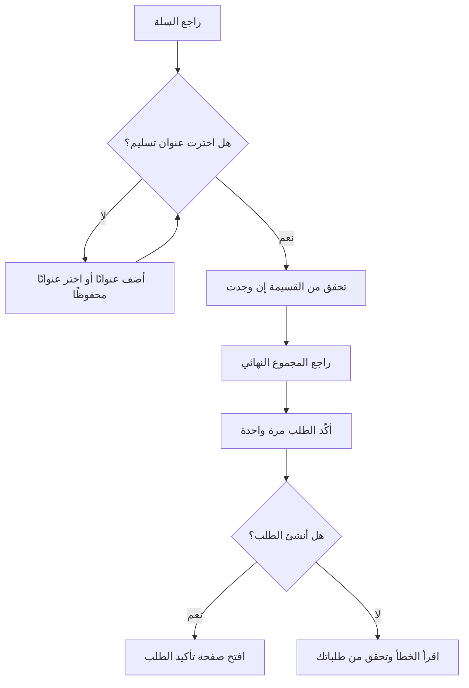

# إنشاء طلب

يجب تسجيل الدخول ووجود منتج واحد على الأقل في السلة. يحتاج إتمام الطلب أيضًا إلى عنوان تسليم؛ يبقى زر التأكيد غير متاح حتى تختار عنوانًا.

## إتمام الطلب

1. افتح [السلة](/ar/docs/shopping/cart) واختر **المتابعة لإتمام الطلب**. راجع المنتجات والكميات قبل مغادرة السلة.
2. اختر عنوان تسليم محفوظًا. إذا لم يكن لديك عنوان، اختر **إضافة عنوان جديد**، وأكمل الحقول المطلوبة، ثم احفظه. يحدد العنوان المختار منطقة التوصيل ورسومها.
3. **اختياري:** أدخل رمز القسيمة واختر **تحقق**. تابع بعد ظهور تأكيد قبولها. يمكنك إزالة القسيمة المطبقة باستخدام **إلغاء**.
4. راجع **ملخص الطلب**. يعرض مبالغ المتاجر، والمجموع الفرعي، وضريبة العميل، والتوصيل، وأي خصم، والمجموع النهائي. تُحسب رسوم التوصيل مرة واحدة للطلب في صفحة الإتمام، وليس في السلة.
5. اضغط زر التأكيد مرة واحدة وانتظر النتيجة. لا ترسل الطلب مجددًا أثناء المعالجة.

## بعد التأكيد

تعرض صفحة **تم تأكيد الطلب** رقم الطلب، والمنتجات مجمّعة بحسب المتجر، وعنوان التسليم عند توفره، والمجموع النهائي. اختر **عرض تفاصيل الطلب** لمتابعته. لا يعني تأكيد الطلب وحده إتمام دفع ببطاقة.

إذا ظهر خطأ أو أُغلقت الصفحة قبل ظهور التأكيد، فتحقق من [طلباتك](/ar/docs/account/orders) قبل المحاولة مرة أخرى.

## إذا لم تتمكن من المتابعة

| ما يظهر لك | ما عليك فعله |
| --- | --- |
| السلة فارغة | أضف منتجًا ثم عُد إلى صفحة الإتمام. |
| زر التأكيد غير متاح | اختر عنوان تسليم أو أضف عنوانًا جديدًا. |
| القسيمة مرفوضة | راجع الرمز والرسالة الظاهرة؛ فقد تكون غير فعالة أو منتهية أو مستنفدة أو تتطلب حدًا أدنى أعلى للطلب. |
| يظهر خطأ في ملخص الطلب | اختر **إعادة المحاولة**. إذا استمر الخطأ، عُد إلى السلة وراجع المنتجات. |

## أمثلة من المتجر

تُبرز الصفحة منطقة التوصيل للعنوان المختار، ويعرض الملخص المبلغ الذي ينبغي مراجعته قبل التأكيد.

هذه أمثلة من متجر وتد مارت التجريبي. تختلف المنتجات ومناطق التوصيل والأسعار والخيارات المتاحة بحسب المتجر.
