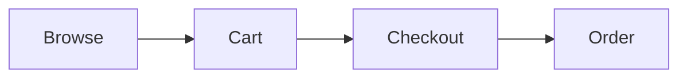
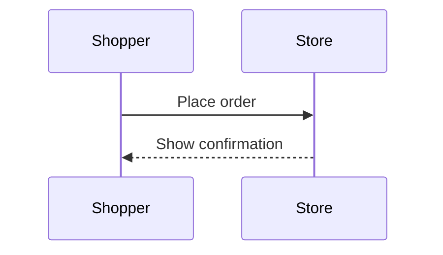
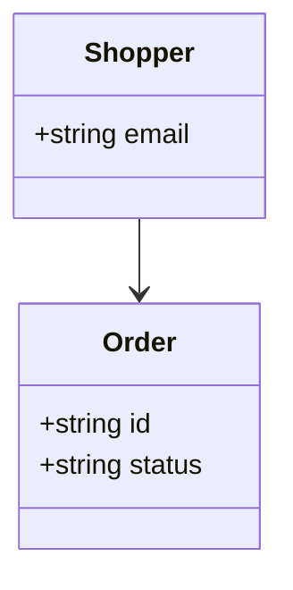
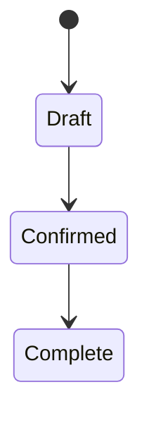
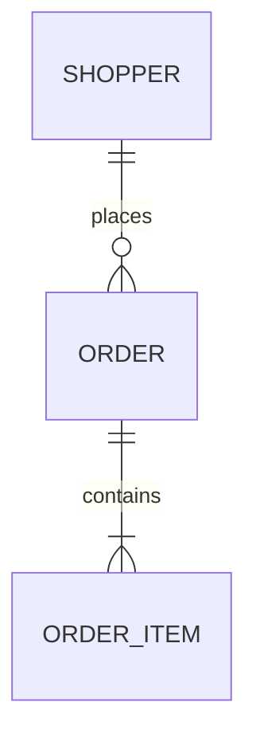
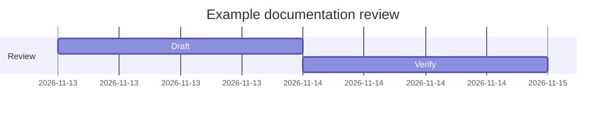
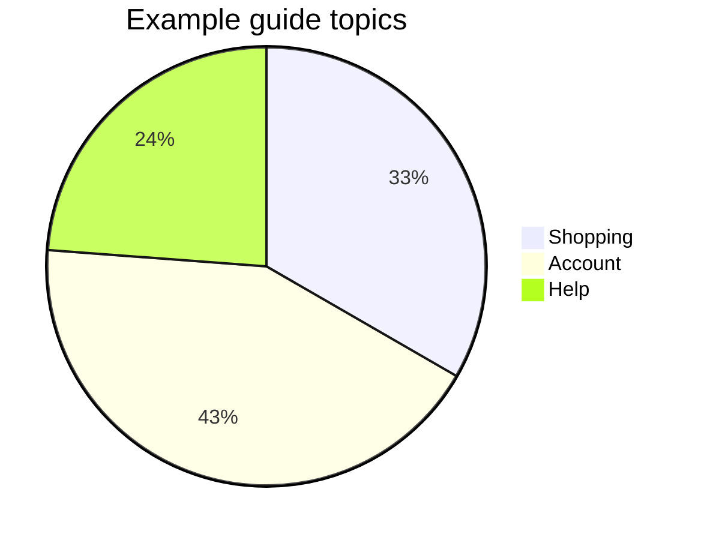
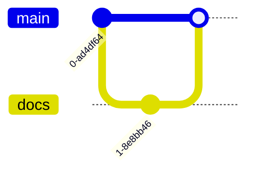
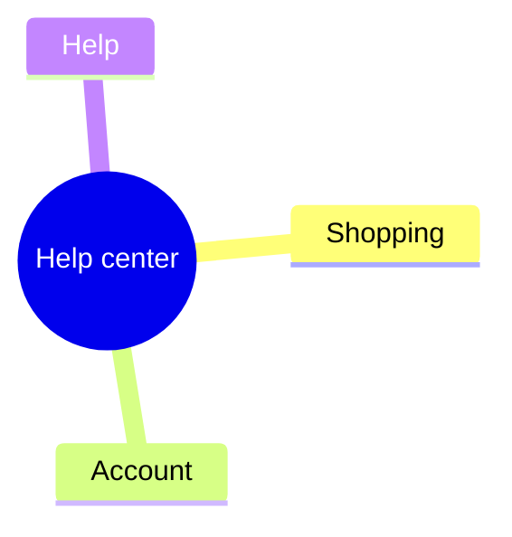

# Markdown and MDX authoring reference

This is an **authoring reference**, not a shopper guide. Use only the formats that make a particular guide easier to read. The ordinary guides stay short and task focused.

## Text and headings

A paragraph can contain **bold**, *italic*, ***bold italic***, and ~~strikethrough~~ text. Use `inline code` for literal interface values or commands. Escape a marker such as \* when you want it printed. Add two trailing spaces for a manual line break.  
This sentence starts on the next line. Emoji such as ✅ can be used sparingly.

### Level three

#### Level four

##### Level five

###### Level six

> A blockquote is useful for an exact excerpt. Attribute quoted material and keep it short.

---

## Lists and tables

1. Start with the first action.
2. Complete the second action.
   1. Use a nested step only when it belongs to the parent action.

- A short unordered item.
  - A nested item with more detail.
- Another item.

- [x] Confirm the article title.
- [ ] Verify the screenshot in the live store.

| Format | Best use |
| --- | --- |
| Table | Compare a small set of options |
| List | Show actions in order |

## Links, images, and navigation

Use [the shopping overview](/en/docs/shopping) for a normal link. The [reference link][account-guide] form keeps long URLs out of a paragraph. [Jump to components](#components-and-html) uses an anchor generated from a heading. Relative links, such as `./shopping/index.md`, should be resolved and checked before publishing; public guides currently use locale-qualified links.


[](/en)

The table of contents on the page is generated from headings. YAML front matter at the top of this file supplies its title and description.

## Code and technical blocks

The language on a fenced block enables syntax highlighting:

```js
const guide = { locale: "en", published: true };
console.log(guide.locale);
```

An API documentation block should name the request, parameters, and response. This example is illustrative and is **not** a Saleswise endpoint:

```http
GET /example/orders/{id} HTTP/1.1
Accept: application/json
```

| Parameter | Type | Meaning |
| --- | --- | --- |
| `id` | string | Example order identifier |

Use a diff block to show a small change:

```diff
-Old guide title
+Updated guide title
```

For shortcuts, write `<kbd>Ctrl</kbd> + <kbd>K</kbd>`. Superscript and subscript use `x<sup>2</sup>` and `H<sub>2</sub>O`. An abbreviation can use `<abbr title="Application Programming Interface">API</abbr>`. These HTML examples are shown as source because the Markdown renderer does not preserve every HTML element.

## Components and HTML

```mdx
import { Callout } from 'fumadocs-ui/components/callout';

<Callout type="info" title="Information">
  A callout highlights a detail the reader needs for the current task.
</Callout>

<Callout type="warning" title="Check before publishing">
  A warning should describe a real limitation or consequence.
</Callout>
```

Alerts and admonitions also have source syntaxes. Enable the matching renderer plugin before using them in a shopper guide:

```md
> [!NOTE]
> Check the live store for its current payment choices.

:::warning
Confirm the order total before placing the order.
:::
```

```mdx
import { Tabs, Tab } from 'fumadocs-ui/components/tabs';

<Tabs items={["Markdown", "MDX"]}>
  <Tab>Markdown covers text, lists, links, images, tables, and code fences.</Tab>
  <Tab>MDX can render imported React components such as these tabs.</Tab>
</Tabs>
```

<details>
  <summary>Collapsible detail</summary>
  <p>Put optional detail here so the main instructions remain short.</p>
</details>

The `<Callout>` syntax above is also an example of a custom MDX component. Badges and definition lists can be authored with components or HTML after renderer support is configured:

```html
<span class="sw-docs-badge">Draft example</span>
<dl>
  <dt>Guide</dt>
  <dd>A task-focused article for a shopper.</dd>
  <dt>Module overview</dt>
  <dd>An introduction and links to related guides.</dd>
</dl>
```

```mdx
import { Files, Folder, File } from 'fumadocs-ui/components/files';

<Files>
  <Folder name="content/docs" defaultOpen>
    <File name="en/shopping/index.md" />
    <File name="ar/shopping/index.md" />
  </Folder>
</Files>
```

MDX comments use `{/* a comment visible in source only */}`. A Markdown HTML comment uses `<!-- comment -->` in a `.md` file; MDX requires the JSX form.

## Media embeds

Embed videos, audio, and PDFs only when a reviewed local asset exists. These examples are source snippets, so they do not make broken requests:

```html
<video controls src="/media/checkout-demo.mp4"></video>
<audio controls src="/media/order-status.mp3"></audio>
<iframe title="Printable guide" src="/media/guide.pdf"></iframe>
```

## Math and diagrams

LaTeX source uses `$x^2$` inline or a `$$...$$` block. Rendering equations requires math plugins that are not configured in this site, so keep equations as source until that support is added:

```tex
\text{Order total}=\sum_i(\text{price}_i\times\text{quantity}_i)+\text{delivery}
```

The Mermaid examples below render as diagrams. Expand **View Mermaid source** beneath each diagram to inspect its syntax.

### Flowchart



### Sequence diagram



### Class diagram



### State diagram



### Entity relationship diagram



### Gantt chart



### Pie chart



### Git graph



### Mind map



## Citations and footnotes

A footnote can carry a short citation or clarification.[^source] Prefer a direct link to the relevant source when a claim needs verification.

[^source]: The examples on this page describe formatting, not store behavior. See the [Fumadocs Markdown guide](https://www.fumadocs.dev/docs/markdown) for renderer details.

[account-guide]: /en/docs/account
