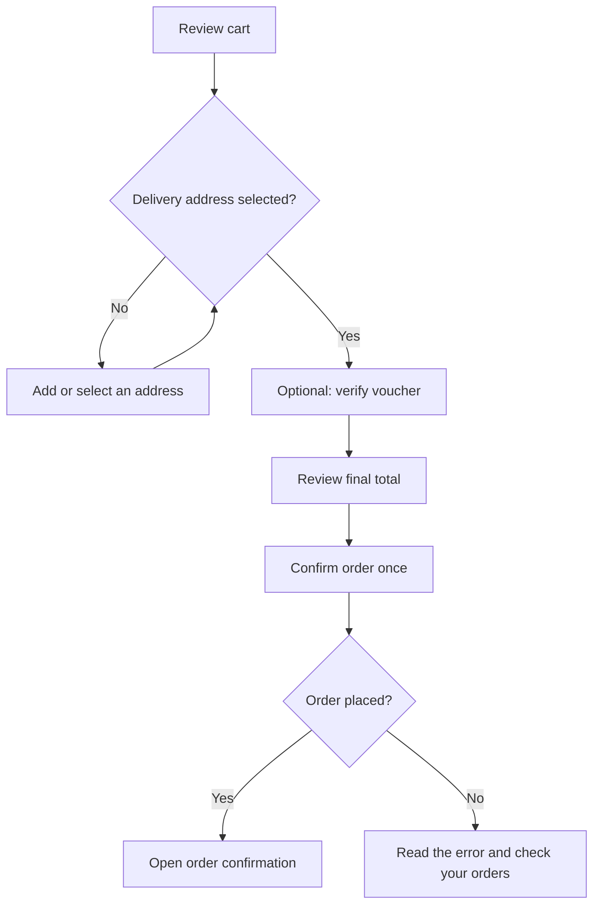

# Place an order

You need to be signed in and have at least one item in your cart. Checkout also needs a delivery address; the confirmation button stays unavailable until you select one.

## Complete checkout

1. Open your [cart](/en/docs/shopping/cart) and select **Proceed to checkout**. Check the items and quantities before leaving the cart.
2. Select a saved delivery address. If you have none, select **إضافة عنوان جديد** (Add new address), complete the required fields, and save it. The selected address determines the delivery area and its charge.
3. **Optional:** Enter a voucher code and select **تحقق** (Verify). Continue only after the page confirms that it applies. You can remove an applied code with **إلغاء** (Cancel).
4. Review the **Order summary**. It shows the store totals, subtotal, customer tax, delivery, any discount, and the final total. Delivery is charged once for the order and is calculated at checkout, not in the cart.
5. Select the confirmation button once and wait for the result. Do not send the order again while it is processing.

## After confirmation

The **Order confirmed** page displays the order number, items grouped by store, the delivery address when available, and the final total. Select **View order details** to follow the order. An order confirmation does not by itself mean a card payment was completed.

If checkout reports an error or the page closes before confirmation appears, check [your orders](/en/docs/account/orders) before trying again.

## If you cannot continue

| What you see | What to do |
| --- | --- |
| The cart is empty | Add an item, then return to checkout. |
| The confirmation button is unavailable | Select or add a delivery address. |
| The voucher is rejected | Check its code and the message shown. It may be inactive, expired, used up, or require a higher order value. |
| The order summary shows an error | Select **Retry**. If it persists, return to the cart and check its items. |

## Example screens

The selected address highlights its delivery area; the summary shows the amount to review before confirming.

These are examples from the WatadMart test store. Products, delivery areas, prices, and available options vary by store.
